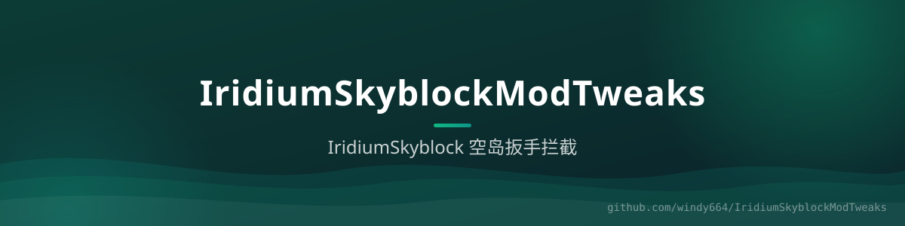

<div align="center">



# IridiumSkyblockModTweaks

**IridiumSkyblock 空岛 Mod 物品保护** —— 拦截对非自己岛屿使用各类科技扳手（Create / PowAH / TechReborn / AE2 …）的行为。


[功能](#-功能) · [配置](#️-配置)

</div>

## ✨ 功能

- **空岛范围拦截**：只在 `island_worlds` 列出的 IridiumSkyblock 世界生效，非空岛世界零干扰
- **扳手黑名单**：右键使用 `disabledItems` 中的扳手时，若目标不在玩家自己的岛屿范围内则取消事件
- **自定义提示**：拦截消息可配，支持颜色代码
- **debug 模式**：`debug: true` 输出判定细节，方便排查为什么没拦住

默认内置拦截：`CREATE_WRENCH`、`POWAH_WRENCH`、`TECHREBORN_WRENCH`、AE2 石英扳手 ×2、`INDREV_WRENCH`、`MODERN_INDUSTRIALIZATION_WRENCH`、`ADVANCED_REBORN_CONFIG_WRENCH`。

> 同系列插件：[BentoBoxModFix](https://github.com/windy664/BentoBoxModFix) · [HusktownsPrevent](https://github.com/windy664/HusktownsPrevent) · [PlotsquaredModFix](https://github.com/windy664/PlotsquaredModFix)

## ⚙️ 配置

```yaml
disabledItems:
  - CREATE_WRENCH
  - POWAH_WRENCH
  - MODERN_INDUSTRIALIZATION_WRENCH

messages: "&8[&c✘&8] &f你没有权限在这个空岛使用这个扳手！"

island_worlds:
  - IridiumSkyblock
  - IridiumSkyblock_nether
  - IridiumSkyblock_the_end

debug: false
```

## 🔨 构建

```bash
./gradlew build
```
